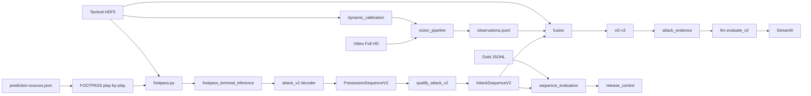

# Tài liệu tham chiếu `football-attack-thesis`

Bộ tài liệu này mô tả **toàn bộ mã nguồn** của package `attack_analysis` (thư mục `src/attack_analysis/`), ứng dụng Streamlit (`app/streamlit_app.py`), các script trong `runs/` và bộ test. Tài liệu được viết từ việc đọc trực tiếp code (ngày 2026-10-06), không phải từ các plan cũ.

Release hiện tại: **`research_only`**. Không có đường code nào tự nâng trạng thái này; P11 (nhãn gold người + kiểm định xG theo miền) không đóng được bằng code.

## Mục lục

| File | Nội dung |
| --- | --- |
| [architecture.md](architecture.md) | Kiến trúc tổng thể, 4 luồng dữ liệu chính (FOOTPASS → Attack-v2, video → observations, fusion → xG → LLM, gold → release), hệ tọa độ, source tier |
| [modules.md](modules.md) | Tham chiếu từng module: mục đích, class/hàm public, hằng số, phụ thuộc |
| [cli.md](cli.md) | Toàn bộ 51 lệnh `attack-analysis` với tham số và mặc định |
| [streamlit-app.md](streamlit-app.md) | Giao diện Streamlit: 3 tab, cache, luồng calibration + YOLO, kết luận LLM |
| [data-and-artifacts.md](data-and-artifacts.md) | File dữ liệu, schema version, biến môi trường, cache, model, registry |
| [testing-and-ops.md](testing-and-ops.md) | Cài đặt, chạy test, script `runs/`, vận hành hằng ngày |
| [known-issues.md](known-issues.md) | Các lỗi/giới hạn ở mức code phát hiện khi đọc nguồn |

Tài liệu chuyên đề có sẵn (không lặp lại ở đây): [../attack-v2.md](../attack-v2.md) (đặc tả ontology), [../prediction-sources.md](../prediction-sources.md), [../gold-annotation-runbook.md](../gold-annotation-runbook.md), [../ops-checklist.md](../ops-checklist.md), [../pipeline-issues.md](../pipeline-issues.md), [../ball-accuracy-plan.md](../ball-accuracy-plan.md), [../action-model-card.md](../action-model-card.md), [../implementation-status.md](../implementation-status.md), [../session-notes-2026-10-09.md](../session-notes-2026-10-09.md) (biên bản việc đã làm và chỗ còn sai, 2026-10-07 → 2026-10-09).

## Tóm tắt một trang

Dự án phân tích **đợt tấn công bóng đá** theo hướng possession-first:

1. **Event**: chuỗi hành động FOOTPASS (oracle hoặc dự đoán DST/TAAD) được chuyển thành `ObservedActionV2`, suy luận terminal (header thành `headed_attempt`, block thành `forced_goal_line_out`), rồi decoder tất định cắt thành `PossessionSequenceV2`.
2. **Attack-v2**: một possession là attack khi và chỉ khi trạng thái `complete` và terminal thuộc `{shot_attempt, headed_attempt, forced_goal_line_out}`.
3. **Video**: YOLO (pose + detect + BoT-SORT/ByteTrack) trên cửa sổ video Full HD, homography động từ tactical HDF5 FOOTPASS, xuất `observations.jsonl` + báo cáo chất lượng.
4. **Fusion + xG-v2**: ghép terminal với track YOLO và freeze-frame HDF5, suy body part / play pattern / GK / đối thủ, chấm xG-v2 (74 đặc trưng có missingness mask).
5. **Kết luận**: `EvidenceBundle` được đưa vào LLM (OpenAI Responses, schema `attack-verdict-v2`), bắt buộc trích dẫn evidence id và **cấm nhãn hiệu quả dạng categorical**.
6. **Đánh giá và release**: nhãn gold người liên tục trên 12 trận (train 6, dev 3, frozen test 3 được niêm phong), metric tIoU, cổng chấp nhận và cơ chế test cuối dùng một lần.

## Quy mô mã nguồn

- `src/attack_analysis/`: 66 module, khoảng 26 nghìn dòng.
- `app/streamlit_app.py`: khoảng 2000 dòng.
- `tests/`: 50 file test (332 test OK, 1 skip ở lần chạy gần nhất).
- CLI: 51 mục trong `COMMANDS` (50 parser + alias `analyze-clip`).

Thư mục `build/lib/` là bản build cũ của setuptools (thiếu nhiều module mới); không dùng làm nguồn tham chiếu.
