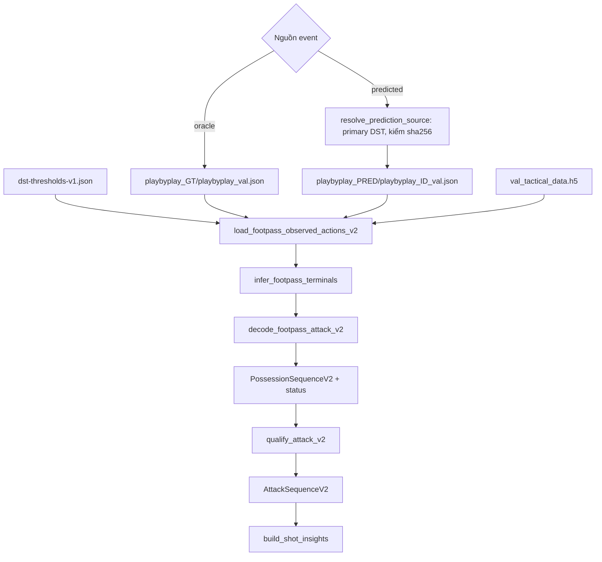
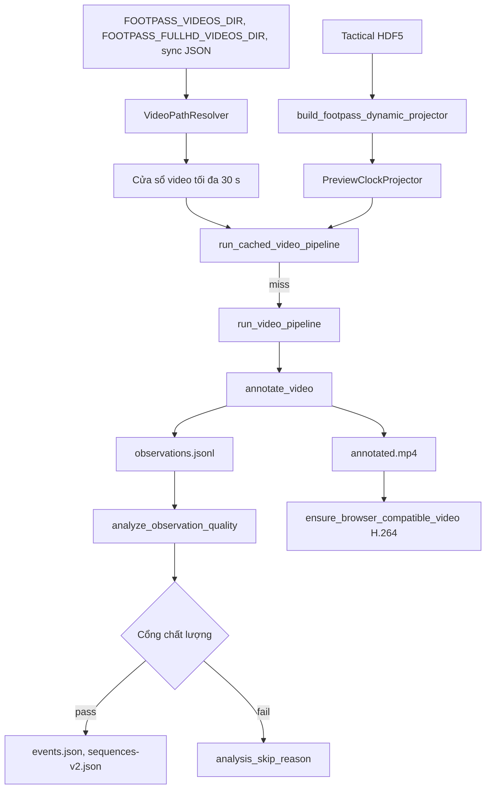
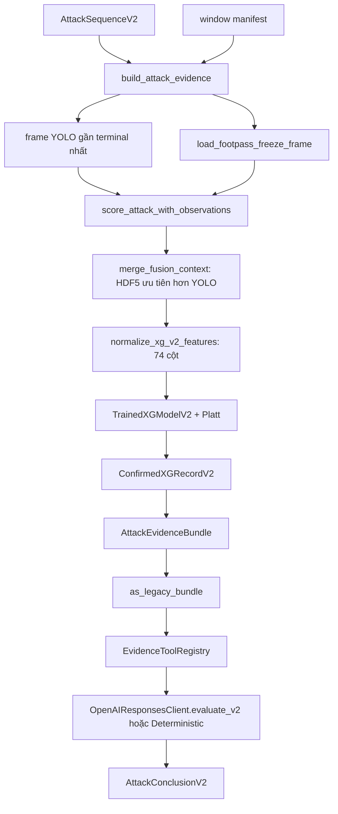
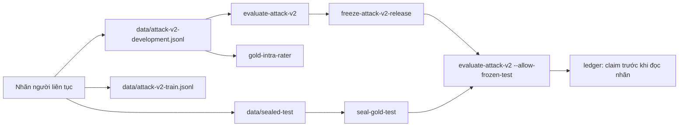

# Kiến trúc và luồng dữ liệu

Tài liệu này mô tả cách các module ghép với nhau. Chi tiết hàm/hằng số nằm ở [modules.md](modules.md).

## 1. Phân lớp

| Lớp | Module | Vai trò |
| --- | --- | --- |
| Hợp đồng miền | `models`, `observations`, `research`, `provenance` | Dataclass bất biến có kiểm tra, id băm nội dung, provenance artifact |
| Event FOOTPASS | `footpass`, `footpass_terminal_inference`, `event_calibration`, `prediction_sources`, `footpass_audit` | Đọc play-by-play + HDF5, ngưỡng theo lớp, registry nguồn dự đoán |
| Decoder Attack-v2 | `attack_v2`, `attack_v2_shot_insights`, `v2_adapters` | Cắt possession tất định, định nghĩa attack, audit cú sút |
| Vision | `vision_pipeline`, `dynamic_calibration`, `geometry`, `field_geometry`, `roi`, `scene`, `team`, `motion`, `video`, `video_paths`, `browser_video` | YOLO, tracking, homography, đồng bộ đồng hồ video |
| Chất lượng + pipeline | `quality`, `pipeline`, `upload_pipeline`, `window_analysis`, `event_inference` | Báo cáo chất lượng, cổng suy luận event, cache theo nội dung |
| Fusion + xG | `fusion`, `xg`, `xg_v2`, `xg_data`, `xg_training_v2`, `attack_evidence` | Ghép terminal với YOLO/HDF5, xG-v2, evidence bundle |
| Kết luận | `llm`, `agent_tools`, `mcp_server`, `web_search`, `benchmarks`, `overview` | LLM có công cụ whitelist, benchmark đóng băng, Brave |
| Đánh giá + release | `sequence_evaluation`, `research_evaluation`, `detection_evaluation`, `tracking_evaluation`, `gold_annotations`, `release_control` | Metric, nhãn gold, niêm phong test, release đóng băng |
| Hạ tầng mô hình học | `action_spotting_v2`, `temporal_model`, `ml`, `training`, `yolo_dataset`, `soccernet` | Hợp đồng cho mô hình tương lai (chưa train), train bóng, xG-v1 |
| Legacy V1 | `segmentation`, `scoring`, `metrics`, `possession`, `attack_features`, `annotations` | Chấm điểm "hiệu quả" kiểu cũ; chỉ còn để ablation/tương thích |
| Giao diện | `cli`, `app/streamlit_app.py`, `env`, `environment`, `pitch_visualization` | CLI JSON, Streamlit, cấu hình môi trường |

## 2. Luồng A: FOOTPASS → Attack-v2

1. **Chọn nguồn.** Oracle là ground truth. Predicted đi qua registry `models/prediction-sources.json`: mặc định là primary (luôn là DST), file được kiểm SHA-256 trước khi đọc.
2. **Lọc ngưỡng.** Dòng dự đoán bị loại khi `confidence < max(min_confidence, threshold[class])`. Ngưỡng theo lớp được fit bằng `calibrate-footpass-events` trên `game_18` và giữ ngoài `game_24/47`.
3. **Adapter.** `load_footpass_observed_actions_v2` tạo `ObservedActionV2`: team id ổn định theo roster (`{match}:roster-100/200`), tọa độ mét theo hướng tấn công của đội thực hiện, cờ replay (oracle có sẵn; predicted suy từ việc không có hàng HDF5 nào visible), provenance từng field, evidence id.
4. **Suy luận terminal.** `header` được gắn qualifier `headed_attempt` khi có cross cùng đội trong 8 s trước, hoặc shot/block ngay sau trong 0.5 s, hoặc ở 1/3 cuối sân khi đội đang kiểm soát. `block` được gắn `forced_goal_line_out` khi theo sau một attempt của đối phương trong 0.5 s và quả ném biên tiếp theo thuộc đội tấn công trong 8 s. `action_type` không bao giờ bị đổi.
5. **Decoder.** Bỏ replay và trùng lặp, gom cụm 0.5 s; kết thúc possession khi gặp terminal, ném biên (terminal tổng hợp `unforced_out`) hoặc khi đội khác kiểm soát (terminal tổng hợp `turnover`). Khoảng trống quá 8 s, scene cut và đổi hiệp làm censor hai phía; replay không rõ làm `uncertain`. Tranh chấp (tackle, block, header thường) không đổi quyền kiểm soát.
6. **Định nghĩa attack.** `qualify_attack_v2`: `status == complete` và terminal trong allowlist. Goal **không** phải terminal; kết quả cú sút là `shot_outcome`.
7. **Audit cú sút.** Mỗi cú sút sống được phân loại `promoted`, `censored` (kèm lý do) hoặc `unassigned`. Kết quả cú sút lấy theo thứ tự: gold, terminal, action.

## 3. Luồng B: Video → observations

- **Đồng hồ.** FOOTPASS dùng frame trận 25 fps; video Full HD có fps và offset riêng. `PreviewClockProjector` đổi frame Full HD sang frame trận trước khi tra homography. Thiếu file sync, offset mặc định 0 s (hiện chỉ `game_18` có offset thật).
- **Homography động.** Mỗi frame mẫu: góc dưới giữa bbox HDF5 (ảnh) ↔ vị trí cầu thủ HDF5 (sân), RANSAC, giữ lại 1/4 điểm làm holdout. Frame hợp lệ khi median ≤ 0.5 m, p90 ≤ 1.5 m, inlier ≥ 0.6. Nội suy tối đa 25 frame, ngoại suy tối đa 25 frame. Báo cáo `pass` khi độ phủ ≥ 0.9.
- **YOLO mỗi frame.** Pose, detect người + BoT-SORT, detect bóng + ByteTrack (tile tùy chọn, mặc định tắt), ghép pose theo IoU > 0.05, pose trên crop cho người thiếu keypoint, team k-means theo màu áo Lab, chiếu lên sân, heuristic GK, tốc độ EMA.
- **Fallback video-only.** Khi không có projector oracle và bật `field_lines`, homography từ tứ giác cỏ được dùng với confidence cố định 0.25.
- **Cổng suy luận event** (`pipeline.py`): chất lượng không `fail`, có projector, calibration `pass`, độ phủ calibrated ≥ 0.8, bóng ≥ 0.5 frame, tracking và continuity đạt, team ≥ 0.7. Thực tế với bóng F1 0.474 thì nhánh event từ video gần như luôn bị bỏ qua, và đó là hành vi đúng.
- **Cache.** `runs/window-cache` (cửa sổ FOOTPASS) và `runs/upload-cache/vision` (clip tải lên). Khóa thư mục là băm của provenance (video, config, model, schema, cây mã nguồn); cache hit chỉ khi provenance khớp và hash output khớp.

## 4. Luồng C: Fusion → xG-v2 → kết luận

- **Ưu tiên nguồn.** Freeze-frame HDF5 thắng cho GK, đếm đối thủ/đồng đội, áp lực, vị trí sút. YOLO bổ sung body part (pose so với bóng hoặc đáy bbox), GK có trong khung hình, liên kết track. Chuỗi event cho play pattern; heuristic hình học cho corner / free kick / penalty (FOOTPASS không có các lớp này). Mỗi field ghi `provenance`.
- **Không withhold vì bóng yếu.** Ball F1 < 0.80 chỉ thêm `ball_quality_warning`; chỉ withhold khi đồng thời thiếu vị trí sút.
- **Withhold xG** khi terminal không phải shot/header (`terminal_not_shot`) hoặc không có model (`no_xg_v2_model`). Event type `shot` ở cuối chuỗi không được withhold: thiếu model hoặc thiếu xác suất là lỗi. Tọa độ thiếu dùng missingness mask của xG-v2, không chặn điểm xG.
- **xG-v2** đang `statsbomb_gate_passed_domain_unvalidated`; runtime luôn cần `allow_research_only=True`.
- **LLM.** Chỉ OpenAI Responses API (`store=False`), model mặc định `gpt-5.4-nano`. Schema strict `attack_conclusion_v2`. `effectiveness_verdict` luôn `None`, `abstained_effectiveness` luôn `True`. Mọi claim phải có evidence id nằm trong bundle. Brave chỉ là ngữ cảnh chữ, không làm nguồn số. Lỗi bất kỳ sẽ fallback sang `DeterministicEvidenceClient`.

## 5. Luồng D: Gold → đánh giá → release

- **Split cố định trong code:** train `6, 8, 16, 21, 33, 48` (game 6 là pilot), development `18, 24, 47`, frozen test `0, 36, 50`.
- **Thứ tự:** development, rồi train, rồi test. Test chỉ được ghi qua `append_sealed_test_annotation_jsonl` và bị khóa sau khi niêm phong.
- **Cổng chấp nhận** (tIoU 0.5): attack P ≥ 0.75, R ≥ 0.75, F1 ≥ 0.80; boundary F1 đầu/cuối ở 1 s ≥ 0.80; median tIoU ≥ 0.80; over/under segmentation ≤ 0.10; terminal macro F1 ≥ 0.85; recall từng terminal ≥ 0.90; cận dưới CI cải thiện F1 so với baseline > 0.
- **Test cuối dùng một lần:** claim được ghi vào ledger **trước** khi đọc nhãn test; lần thứ hai bị từ chối kể cả khi lần đầu crash.

## 6. Hệ tọa độ

| Hệ | Phạm vi | Ở đâu |
| --- | --- | --- |
| FOOTPASS thô | [0, 1] × [0, 1] | HDF5 cột 5–6 |
| Attack-view của actor | 0–105 × 0–68 m, đội thực hiện tấn công về x = 105 | `ObservedActionV2.x/y` |
| Attack-view của possession | Như trên, nhưng hành động của đối thủ được lật x (105 − x) | `actions_in_attack_view` (bắt buộc trước khi tính hình học cấp possession) |
| Homography tuyệt đối | 0–105 × 0–68 m theo HDF5 | `pitch_x/pitch_y` trong observations |
| SoccerNet GSR | ±52.5 × ±34, tâm sân | `soccernet.py`, `detection_evaluation.py` |
| StatsBomb | 120 × 80, scale tuyến tính sang 105 × 68 | `xg_data.py` |

Mọi phép mirror trong code chỉ lật trục x, không lật y. Đây là phép phản xạ chứ không phải xoay 180°, nhưng được dùng nhất quán.

## 7. Source tier

`models.SourceTier`:

- `oracle_actions_oracle_tactical`: event oracle và HDF5.
- `predicted_actions_oracle_tactical`: event dự đoán và HDF5 (chế độ chính của ứng dụng).
- `video_only`: không có HDF5; không có team id nên gần như mọi thứ là `unassigned`.
- `fused`: yêu cầu provenance đầy đủ và ít nhất 2 tier gốc.
- `legacy_unvalidated`: kết quả V1; possession luôn `uncertain`.

`provenance.SourceTier` là một `Literal` khác cùng tên (không có `legacy_unvalidated`), dùng cho manifest artifact.
